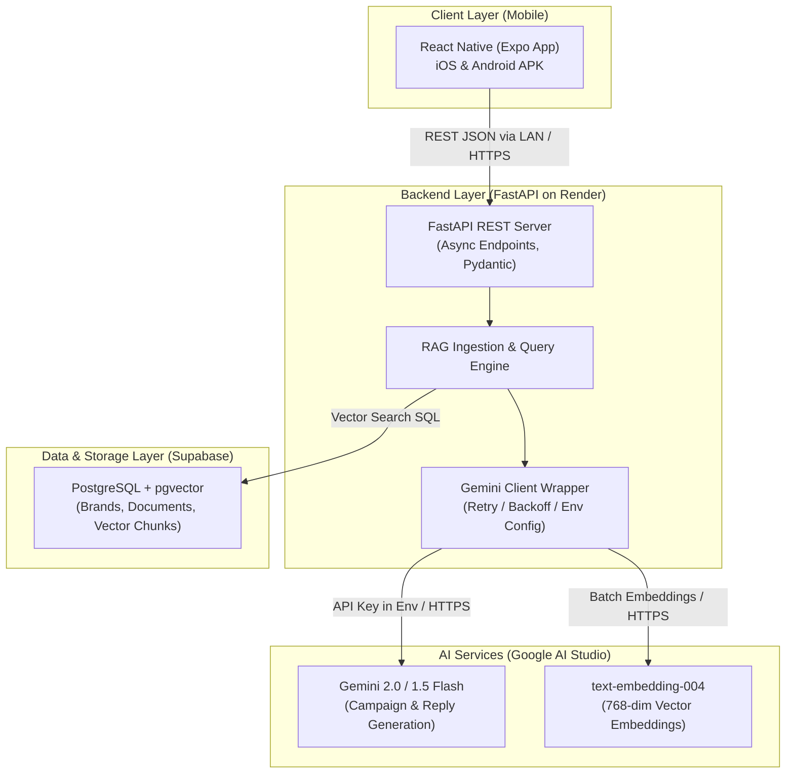

# 01 — System Architecture: Brand Brain

## System Overview

Brand Brain is an AI Campaign Copilot designed for multi-channel marketing automation. It ingests public brand knowledge, indexes it via vector embeddings, and exposes grounded generation endpoints to a mobile client.

---

## Free-Tier Operational Constraints (Verified October 2026)

| Service | Component | Quota / Free Limit | Architectural Mitigation |
|---|---|---|---|
| **Google AI Studio** | Gemini Flash (Generation) | 15 RPM, 1M TPM, 1,500 RPD | Asynchronous exponential backoff on HTTP 429, short concise system prompts |
| **Google AI Studio** | `text-embedding-004` (Embeddings) | 1,500 RPD, ~100 RPM | Batch embedding requests, caching text hashes |
| **Supabase** | PostgreSQL + pgvector | 500 MB DB, auto-pause after 7 days | Reduced vector dimensions where appropriate, health ping before interviews |
| **Render** | FastAPI Backend | Sleeps after 15 min idle, 50s cold start | Mobile app retry logic, pre-warming ping on app launch |

---

## Network & Security Isolation

1. **Zero Secret Leakage:** The mobile client only holds the backend's base URL. `GEMINI_API_KEY` and `SUPABASE_DB_URL` exist solely in the backend environment.
2. **Device Networking Reality:** Physical mobile devices running Expo Go cannot access `http://localhost:8000` because `localhost` refers to the mobile phone itself. Communication requires the host computer's Local Area Network (LAN) IP (e.g., `http://192.168.x.x:8000`).
