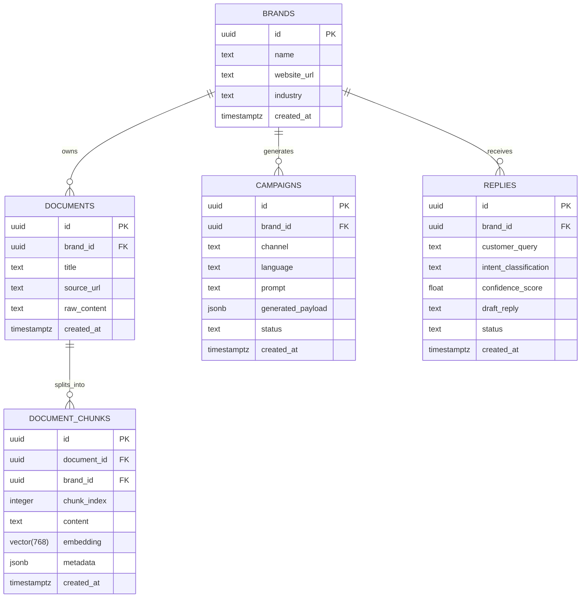

# 02 — Data Model: Brand Brain

## Entity Relationship Overview

The core data model isolates brand identity, ingested documents, chunked text with vector embeddings, and generated marketing artifacts.



---

## PostgreSQL + pgvector Schema DDL

```sql
-- 1. Enable the pgvector extension
CREATE EXTENSION IF NOT EXISTS vector;

-- 2. Brands Table
CREATE TABLE IF NOT EXISTS brands (
    id UUID PRIMARY KEY DEFAULT gen_random_uuid(),
    name TEXT NOT NULL,
    website_url TEXT,
    industry TEXT,
    created_at TIMESTAMPTZ DEFAULT timezone('utc'::text, now()) NOT NULL
);

-- 3. Ingested Raw Documents Table
CREATE TABLE IF NOT EXISTS documents (
    id UUID PRIMARY KEY DEFAULT gen_random_uuid(),
    brand_id UUID NOT NULL REFERENCES brands(id) ON DELETE CASCADE,
    title TEXT NOT NULL,
    source_url TEXT,
    raw_content TEXT NOT NULL,
    created_at TIMESTAMPTZ DEFAULT timezone('utc'::text, now()) NOT NULL
);

-- 4. Vector Chunks Table (The RAG Core)
CREATE TABLE IF NOT EXISTS document_chunks (
    id UUID PRIMARY KEY DEFAULT gen_random_uuid(),
    document_id UUID NOT NULL REFERENCES documents(id) ON DELETE CASCADE,
    brand_id UUID NOT NULL REFERENCES brands(id) ON DELETE CASCADE,
    chunk_index INTEGER NOT NULL,
    content TEXT NOT NULL,
    embedding VECTOR(768) NOT NULL,
    metadata JSONB DEFAULT '{}'::jsonb,
    created_at TIMESTAMPTZ DEFAULT timezone('utc'::text, now()) NOT NULL
);

-- 5. Create an HNSW or IVFFlat Index for sub-millisecond similarity search
CREATE INDEX IF NOT EXISTS document_chunks_embedding_idx 
ON document_chunks 
USING hnsw (embedding vector_cosine_ops);

-- 6. Similarity Search RPC Function
CREATE OR REPLACE FUNCTION match_chunks(
    query_embedding VECTOR(768),
    filter_brand_id UUID,
    match_count INT DEFAULT 5,
    similarity_threshold FLOAT DEFAULT 0.5
)
RETURNS TABLE (
    id UUID,
    document_id UUID,
    content TEXT,
    metadata JSONB,
    similarity FLOAT
)
LANGUAGE plpgsql
AS $$
BEGIN
    RETURN QUERY
    SELECT
        dc.id,
        dc.document_id,
        dc.content,
        dc.metadata,
        1 - (dc.embedding <=> query_embedding) AS similarity
    FROM document_chunks dc
    WHERE dc.brand_id = filter_brand_id
      AND 1 - (dc.embedding <=> query_embedding) > similarity_threshold
    ORDER BY dc.embedding <=> query_embedding
    LIMIT match_count;
END;
$$;
```
