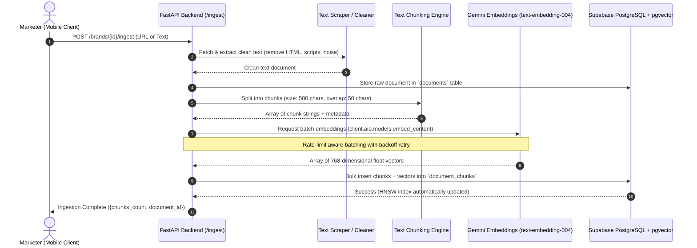

# 03 — Ingestion & Vectorization Flow: Brand Brain

## Ingestion Pipeline Sequence

The ingestion flow transforms raw brand content (websites, product catalogs, FAQ text) into searchable vector embeddings stored in Supabase pgvector.

---

## Architectural Principles & Trade-Offs

1. **Deterministic Multi-Tenancy:**
   Every chunk in `document_chunks` explicitly carries both `brand_id` and `document_id`. Search queries **always** filter by `brand_id = target_brand` first before calculating vector cosine distance. This completely prevents Brand A from ever seeing Brand B's proprietary copy.

2. **HNSW vs IVFFlat Indexing:**
   - **IVFFlat:** Requires a training step and data clustering. Performs poorly when tables are small or rapidly growing.
   - **HNSW (Hierarchical Navigable Small World):** Builds a multi-layer graph of vectors. Offers higher query recall (search accuracy) and faster lookups out of the box with zero pre-training required.
