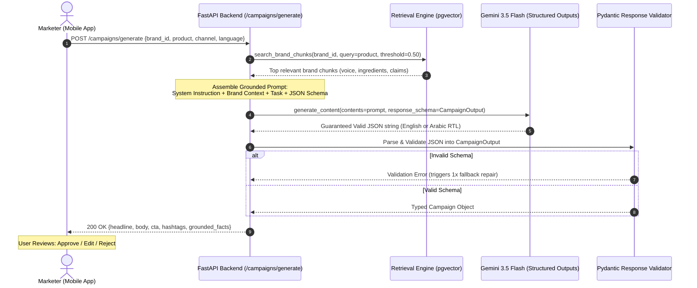

# 04 — RAG Query & Campaign Generation Flow: Brand Brain

## End-to-End Generation Sequence

This diagram shows how retrieved brand chunks are merged with user prompt parameters to produce strictly grounded, validated JSON marketing campaigns in English and Arabic.



---

## The 4 Pillars of Grounded RAG Prompt Anatomy

```
+-----------------------------------------------------------------------------------+
| 1. SYSTEM ROLE                                                                    |
| "You are an elite bilingual marketing strategist for {brand_name}."                |
+-----------------------------------------------------------------------------------+
| 2. GROUNDING CONTEXT (Retrieved from pgvector)                                     |
| "USE ONLY THE FOLLOWING BRAND FACTS. NEVER INVENT CLAIMS NOT FOUND HERE:          |
|  ---                                                                              |
|  {retrieved_chunks}                                                               |
|  ---"                                                                             |
+-----------------------------------------------------------------------------------+
| 3. TASK & CHANNELS                                                                |
| "Create a campaign for product '{product}' on channel '{channel}' (Instagram,    |
|  WhatsApp, Google Ads, or Email) in {language} (English or Arabic)."              |
+-----------------------------------------------------------------------------------+
| 4. STRICT OUTPUT SCHEMA                                                           |
| Enforced via Gemini response_schema / Pydantic:                                   |
| { headline, body_copy, call_to_action, hashtags, direction_rtl }                  |
+-----------------------------------------------------------------------------------+
```

---

## Arabic & RTL Layout Guidelines (GCC Region)

1. **RTL Directionality:** Arabic text is read Right-to-Left. The API returns a boolean `is_rtl: true` so React Native dynamically flips `textAlign: 'right'` and `writingDirection: 'rtl'`.
2. **Cultural Resonance:** In marketing for the UAE and GCC, Arabic copy should match the tone (e.g. Modern Standard Arabic or Gulf dialect nuances) while maintaining strict alignment with approved English claims.
