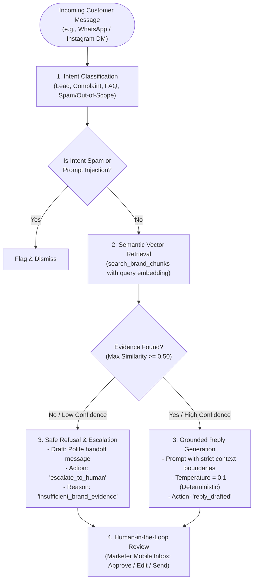

# 05 — Grounded Reply Assistant & Escalation Engine: Brand Brain

## Architecture Overview

The Reply Assistant automates incoming customer messaging (e.g. WhatsApp, Instagram DMs, Web Chat) by classifying customer intent, checking knowledge base evidence, and drafting grounded responses or escalating to human staff.

---

## Intent Taxonomy & Routing

| Intent Category | Definition | System Action |
|---|---|---|
| **FAQ** | Inquiries about products, ingredients, hours, locations, policies | Search vector DB; answer if grounded; escalate if missing |
| **Lead** | Purchase intent, bulk orders, wholesale, partnership requests | Tag as High Priority; collect contact info; notify sales |
| **Complaint** | Dissatisfaction with service, defective product, delivery delay | Empathetic tone; retrieve policy; escalate to senior support |
| **Out-of-Scope** | Irrelevant questions (e.g., weather, politics, competitor info) | Politely decline and redirect to brand offerings |

---

## Refusal & Escalation Strategy (The "Anti-Hallucination" Guardrail)

1. **Threshold Gate:** If `max(similarity) < 0.50`, the system forbids LLM fact generation.
2. **Deterministic Response on Escalation:** The model does not invent answers. It returns a standardized response:
   > *"Thank you for reaching out! To give you the most accurate assistance regarding [Topic], I've routed your request to a team specialist who will follow up shortly."*
3. **Auditability:** Every draft reply records `grounded_chunks_used`, `similarity_score`, and `intent` for quality tracking.

